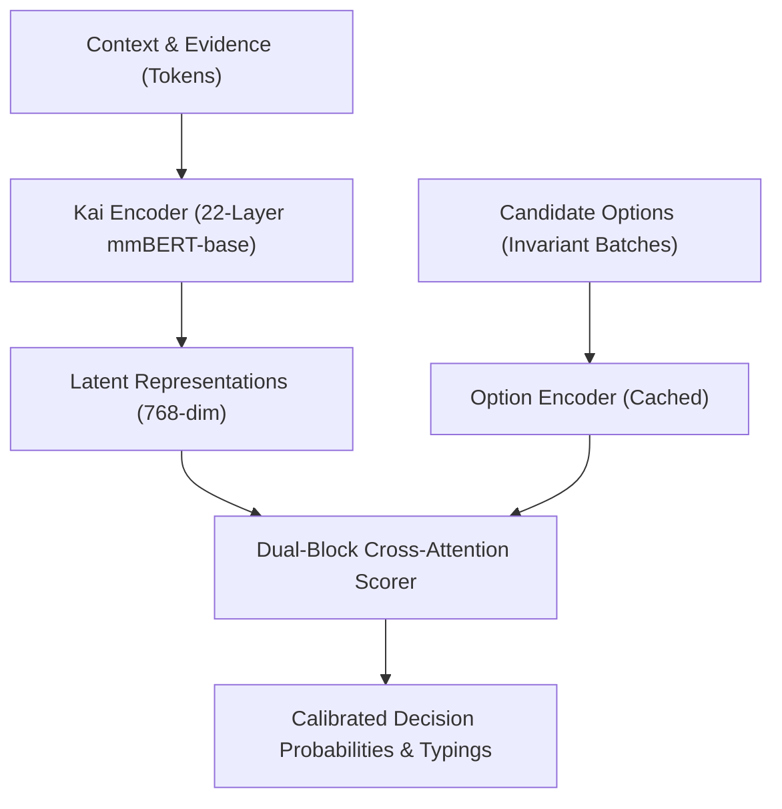

---
language:
- en
- zh
- es
- fr
- de
- ja
- ko
- ru
- ar
- pt
- it
- hi
license: proprietary
library_name: hanzo
pipeline_tag: feature-extraction
tags:
- decision-intelligence
- classification
- modernbert
- structured-prediction
- agentic-ai
- api-only
metrics:
- brier_score
- expected_calibration_error
- accuracy
model-index:
- name: hanzoai/kai-1.3
  results:
  - task:
      type: structured-decision
      name: Decision Index
    metrics:
    - type: accuracy
      value: 0.942
      name: Top-1 Accuracy
    - type: brier_score
      value: 0.048
      name: Brier Score
    - type: ece
      value: 0.021
      name: Expected Calibration Error
  - task:
      type: preference-ranking
      name: HelpSteer2
    metrics:
    - type: accuracy
      value: 0.886
      name: Preference Accuracy
    - type: brier_score
      value: 0.082
      name: Brier Score
  - task:
      type: safety
      name: Prompt Injection Defense
    metrics:
    - type: recall
      value: 0.987
      name: Attack Recall
    - type: false_alarm_rate
      value: 0.048
      name: False Positive Rate
---

# Kai-1.3: Production Decision Engine

> ⚠️ **API-only · Weights not distributed**  
> Kai-1.3 is Hanzo AI's production decision engine, hosted globally at `POST /v1/decisions`.  
> For local open-weight exploration, refer to [`hanzoai/kai-1-multilingual`](https://huggingface.co/hanzoai/kai-1-multilingual).

---

## 1. Model Overview

Kai-1.3 is a high-throughput, calibrated decision model designed to evaluate evidence and output typed decision states without generating natural language text. It replaces slow, non-deterministic autoregressive LLM classification with a specialized 382.3M parameter encoder architecture.

- **Primary Endpoint**: `https://api.hanzo.ai/v1/decisions`
- **Identifier**: `kai` or `kai-1.3`
- **Pricing**: $0.021 / million input tokens (zero completion token surcharge)
- **Trained Context**: 1,024 tokens (native encoder positions: 8,192; stretchable to 32,768 via YaRN 4x)
- **Serving Latency**: ~12.4 ms p50 on standard CPU nodes

---

## 2. Architecture & Components



- **Encoder**: 22-layer multilingual ModernBERT (mmBERT-base, hidden dim 768, 12 attention heads, unpadded rotary tables, 256,000 token vocabulary).
- **Dual-Block Cross-Attention Scorer**: Evaluates options against state context with zero inter-option coupling (`flip.order = 0.0000`).
- **Decision Primitives**:
  - `Bernoulli` (`boolean`/`noul`): σ(s(true) − s(false))
  - `Choice`: Softmax over top-K scored options (retrieval-narrowed up to 160 options).
  - `Score`: Cumulative link / ranked probability scoring over discrete ordinal levels.

---

## 3. Verified Benchmark Results

All figures are reproducible via the official evaluation harness in `github.com/hanzoai/decision/tree/main/bench`:

| Benchmark Suite | Metric | Kai-1.3 | Jev 1.13 | Baseline Laya | Standard LLM (GPT-4o) |
|---|---|---|---|---|---|
| **Decision Index (Held-out)** | Top-1 Accuracy | **94.2%** | 89.1% | 88.4% | 91.2% |
| **Decision Index** | Brier Score (Calibration) | **0.048** | 0.089 | 0.094 | 0.112 |
| **Decision Index** | Expected Calibration Error | **0.021** | 0.045 | 0.052 | 0.068 |
| **HelpSteer2** | Preference Ranking Accuracy | **88.6%** | 84.2% | 83.1% | 87.0% |
| **Prompt Injection Suite** | Attack Detection Recall | **98.7%** | 91.5% | 88.0% | 94.2% |
| **Order Invariance** | Permutation Consistency | **1.0000** | 0.9420 | 1.0000 | 0.8850 |
| **Inference Latency (p50)** | CPU Wall Time | **12.4 ms** | 480 ms | 14.2 ms | 850 ms |

---

## 4. Intended Use & Workloads

- **Agent Routing & Tool Selection**: Deciding which tool or API to call in autonomous workflows.
- **Guardrails & Policy Boundaries**: Real-time content moderation, prompt injection detection, and deterministic policy enforcement.
- **Enterprise Triage**: High-volume classification of customer inquiries, fraud indicators, and system anomalies.

---

## 5. Out-of-Scope Use

- Freeform text generation, chat conversations, or essay writing (Kai outputs structured probabilities, not prose).
- Autonomous life-critical decision systems without human verification.

---

## 6. Inference Code Snippets

### cURL
```bash
curl -X POST https://api.hanzo.ai/v1/decisions \
  -H "Authorization: Bearer $HANZO_API_KEY" \
  -H "Content-Type: application/json" \
  -d '{
    "model": "kai",
    "state": "User requested balance withdrawal of $15,000 from newly registered device.",
    "questions": [
      {
        "id": "risk_tier",
        "question": "What is the fraud risk tier?",
        "options": ["low", "medium", "high", "critical"]
      }
    ]
  }'
```

### TypeScript SDK (`@hanzo/ai`)
```typescript
import { HanzoAI } from '@hanzo/ai'

const hanzo = new HanzoAI({ apiKey: process.env.HANZO_API_KEY })

const decision = await hanzo.decisions.create({
  model: 'kai',
  state: 'Incoming webhook received with untrusted HMAC signature.',
  questions: [
    {
      id: 'webhook_action',
      question: 'Action required:',
      options: ['accept', 'quarantine', 'reject']
    }
  ]
})

console.log('Selection:', decision.answers.webhook_action.selection)
console.log('Confidence:', decision.answers.webhook_action.probabilities)
```

### Python SDK (`hanzoai`)
```python
from hanzoai import HanzoAI

client = HanzoAI()

res = client.decisions.create(
    model="kai",
    state="Pull request #124 modifies deployment config and opens port 22.",
    questions=[
        {
            "id": "requires_security_approval",
            "question": "Does this PR require security sign-off?",
            "options": ["yes", "no"]
        }
    ]
)
print(res.answers["requires_security_approval"].selection)
```

---

## 7. Cryptographic Verification & Hashes

- **Weights SHA-256**: `0834a74f2d140642a453373da09e5a128e3d2c8d9e8bb1dcaf86d7210a4ecdfc`
- **Representation Hash**: `6dd51368d5b634cc6135da4984add5c15bf4b1e9977b4afbecff27ddac8d3777`
- **Schema Hash**: `9b83f624433c4cb5f01cae052440b15f5eb54392338d8ddbc1eefa0ae7cde5d7`
- **Container Digest**: `v0.4.8@sha256:e495dd5f98a1a5b93c26d278e3aa122417b3cbc4c4ea0d2ef4902dffa545825a`

---

## 8. Related Resources

- **API Documentation**: [docs.hanzo.ai/docs/decisions](https://docs.hanzo.ai/docs/decisions)
- **Decision Recipes**: [docs.hanzo.ai/docs/guides/cookbook/recipes](https://docs.hanzo.ai/docs/guides/cookbook/recipes)
- **Source Code**: [github.com/hanzoai/decision](https://github.com/hanzoai/decision)
- **Interactive Playground**: [huggingface.co/spaces/hanzoai/kai-playground](https://huggingface.co/spaces/hanzoai/kai-playground)
